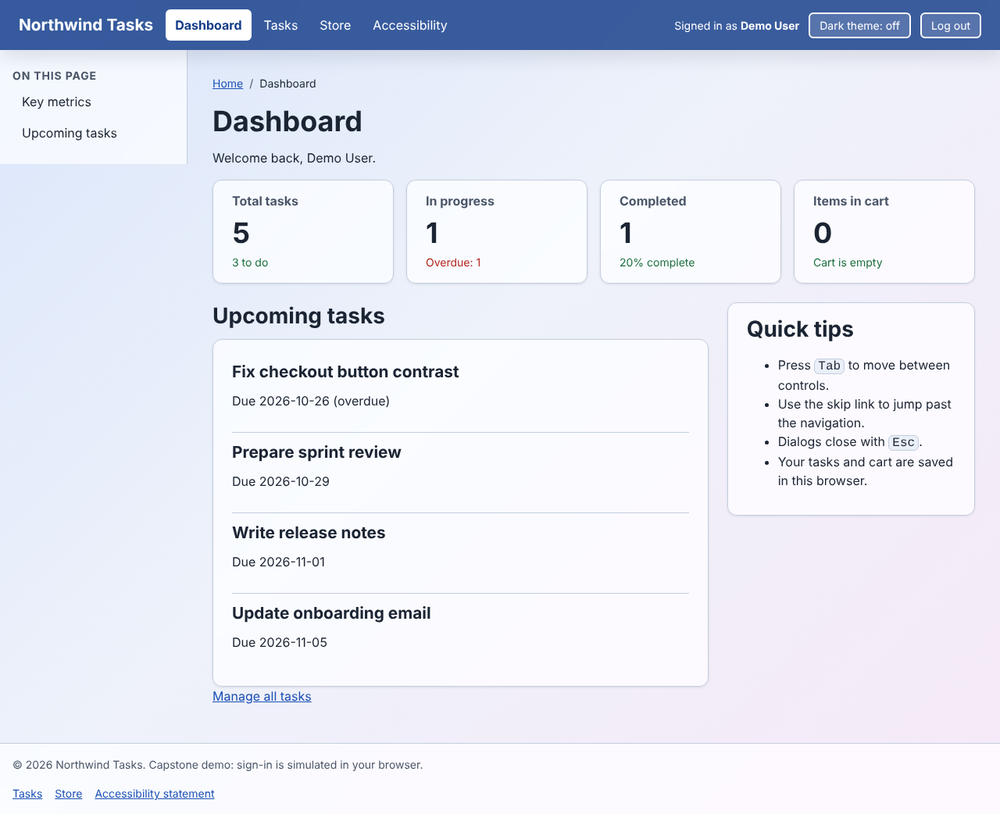
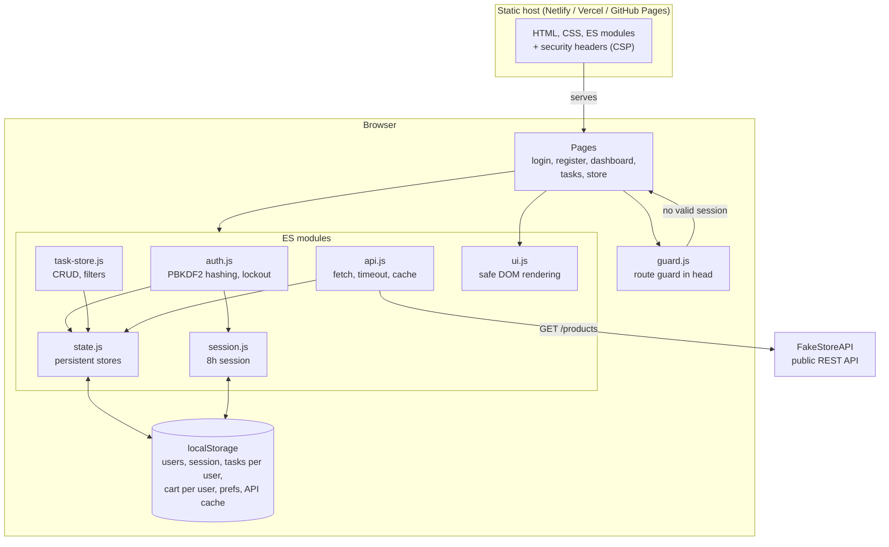
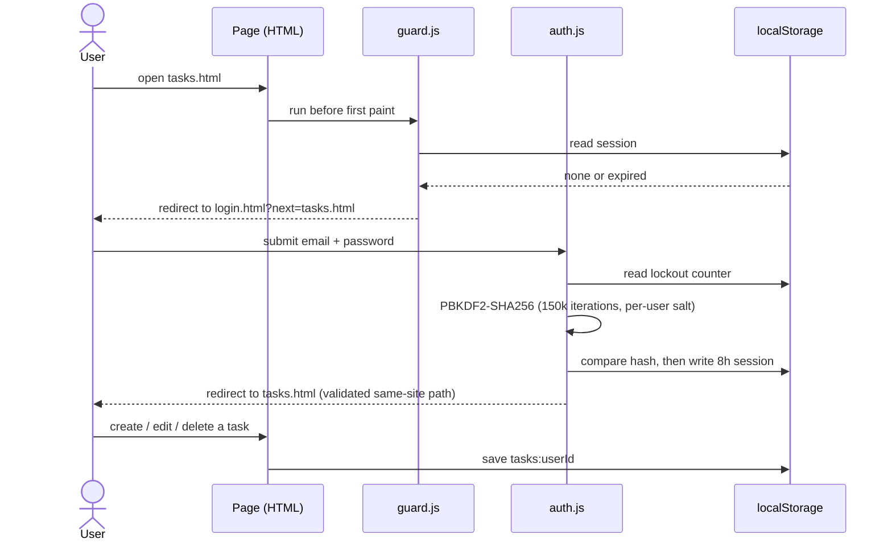
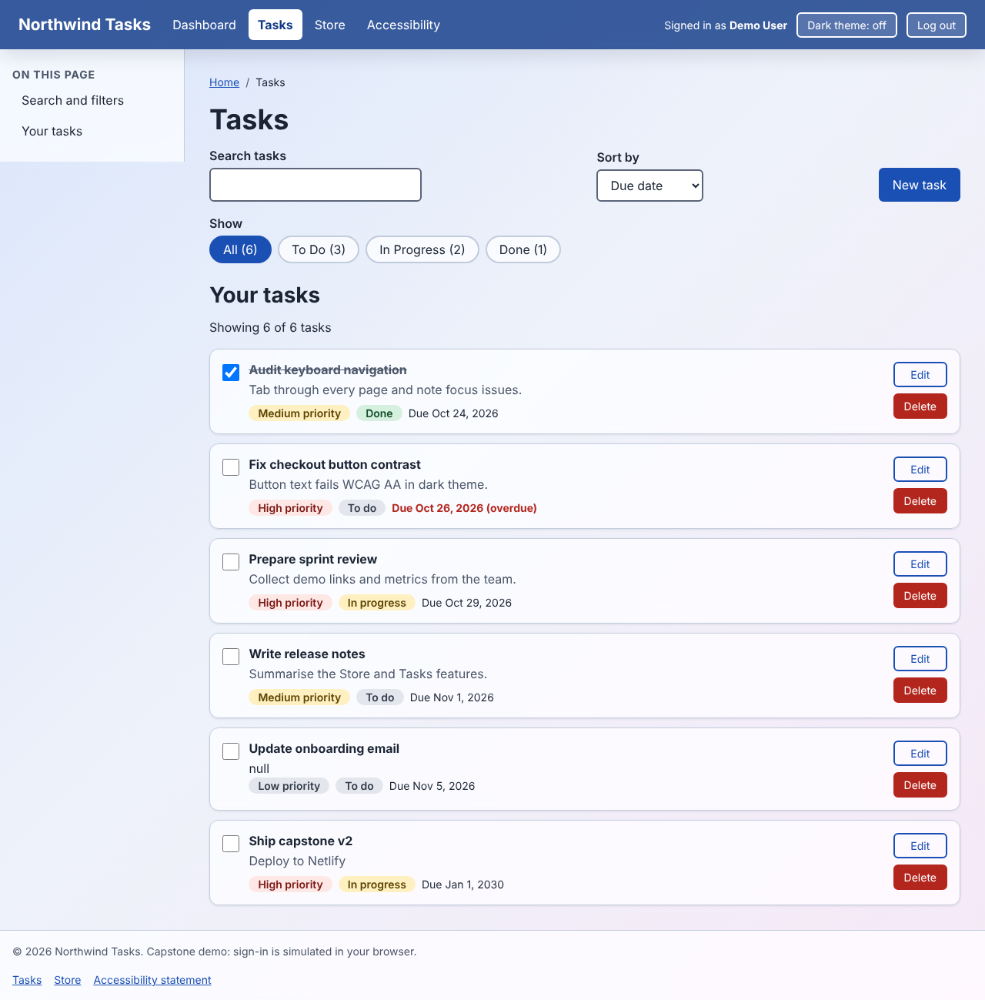
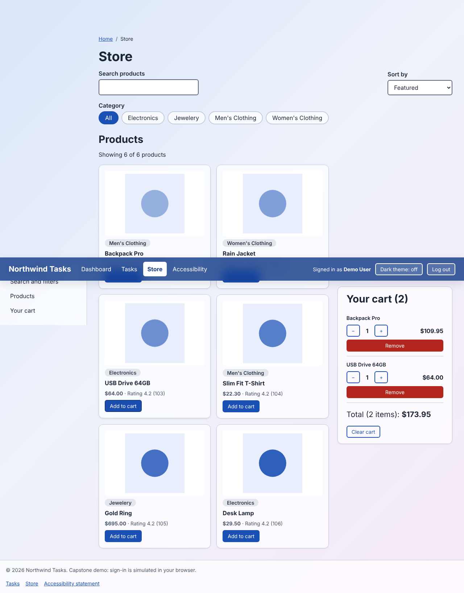
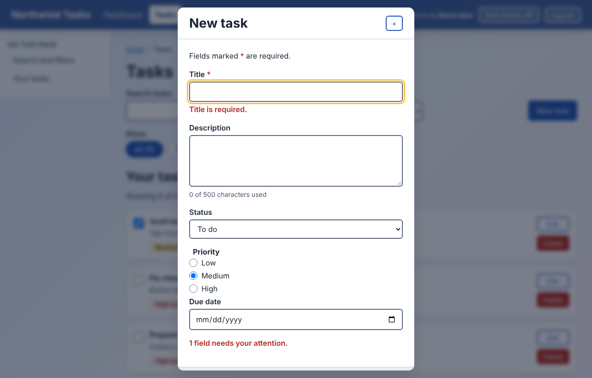
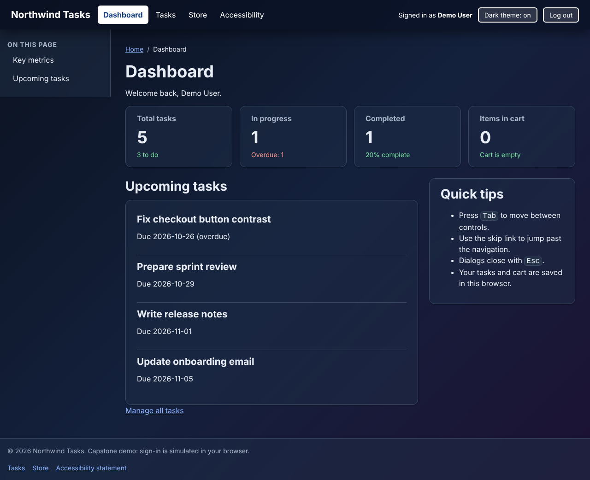
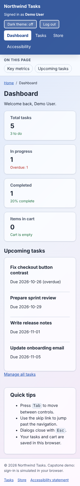
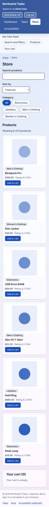

# Northwind: Task Manager + Storefront (Capstone)

A production-style web app built with **vanilla HTML5, CSS and ES modules** (no framework, no build step needed to run). It combines everything from the course: semantic accessible markup, a mobile-first design system, a REST API client, and persistent client-side state, with simulated authentication in front of it.

**Live demo:** _add your deployed URL here after following [Deploy](#deploy)_
**Demo account:** `demo@northwind.test` / `Demo-Pass-2026` (or create your own on the Register page)



## Features

| Area | What it does |
|---|---|
| **Authentication (simulated)** | Register, sign in, sign out. Passwords are salted and hashed with PBKDF2-SHA256 (150,000 iterations) via the Web Crypto API; 5 failed attempts lock the account for 30 seconds; 8-hour sessions; route guard redirects signed-out visitors; `?next=` redirects are restricted to same-site pages (no open redirect). |
| **Dynamic CRUD** | Tasks: create, read, update (edit dialog and done checkbox) and delete (confirm dialog), with live search, status tabs and sorting. |
| **Interactive catalog** | Store page loads live products from [FakeStoreAPI](https://fakestoreapi.com) with search, category buttons, sorting, loading skeletons and error banners with retry. |
| **Persistent state** | Per-user tasks, per-user cart, filter preferences and a 5-minute API cache live in `localStorage`; everything survives reloads. New accounts start with empty data (isolation is tested). |
| **Dashboard** | Live KPIs (tasks, in progress, completed, overdue, cart) and upcoming tasks. |
| **Responsive design system** | Design tokens in `:root`, mobile-first breakpoints (320 / 768 / 1024 / 1440 px), light and dark themes, glass effects, no horizontal scrolling. |
| **Accessibility** | Semantic landmarks, skip link, labelled forms with linked error messages, focus management in dialogs and re-rendered lists, `prefers-reduced-motion`, AA contrast. |
| **Security headers** | Strict Content-Security-Policy, `X-Frame-Options`, `nosniff`, Referrer and Permissions policies (see `netlify.toml` / `vercel.json`). API data is rendered with `textContent`, never `innerHTML`. |

## Architecture



Image version: [`docs/diagrams/architecture.png`](docs/diagrams/architecture.png). Sign-in and data flow: [`docs/diagrams/auth-flow.png`](docs/diagrams/auth-flow.png).



### Design decisions

- **No framework.** The goal is to demonstrate the platform: semantic HTML, CSS custom properties, native `<dialog>`, ES modules, `fetch`.
- **Pure functions for logic** (`filters.js`, `task-store.js` helpers) kept separate from DOM code (`ui.js`, page modules), so they are easy to test and reuse.
- **One tiny store abstraction** (`state.js`): persisted state, `subscribe()`, and a `sanitize` step that cleans anything read back from storage, so tampered or outdated data cannot break the page. Every storage call is wrapped in `try/catch`.
- **Shared markup lives once** in `components/` and `src/`; `build.py` assembles the pages, and the generated HTML is committed so the site deploys with no build.
- **Focus is never lost** when lists re-render (restored by a `data-focus-key`), and dialogs return focus to the control that opened them.

## Project structure

```
├── *.html                  generated pages (login, register, index, tasks, products, accessibility)
├── components/             shared markup: header, sidebar, footer, dialogs
├── src/                    per-page <main> content
├── css/style.css           design tokens, mobile-first layout, components, themes
├── js/
│   ├── guard.js            route guard (classic script in <head>)
│   ├── auth.js, session.js sign-in, register, hashing, sessions
│   ├── state.js            persistent stores, cart
│   ├── task-store.js       task model, CRUD actions, filters, KPIs
│   ├── api.js, filters.js  REST client with cache; search/sort helpers
│   ├── ui.js               DOM helpers and rendering
│   ├── login.js, register.js, dashboard.js, tasks.js, app.js   page controllers
│   └── components/         dialogs, form validation, theme toggle, char counter
├── tests/e2e.test.cjs      Playwright end-to-end suite
├── scripts/dist.mjs        copies the public files into dist/ for deployment
├── netlify.toml, vercel.json, .github/workflows/deploy.yml     deployment config
└── docs/                   screenshots and diagrams
```

## Run locally

Requires Node 18+ and Python 3 (any static file server works; ES modules need `http://`, not `file://`).

```bash
npm install            # dev tools only: Playwright and the W3C validator
npm start              # http://localhost:8080
```

Edit shared markup in `components/` or `src/`, then run `npm run build` to regenerate the pages.

## Test

```bash
npx playwright install chromium
npm start &            # keep the site running
npm test               # 31 end-to-end checks
npm run validate       # W3C Nu HTML + CSS validator (needs Java), expected: no output
```

The suite covers the route guard, sign-in, lockout, open-redirect protection, registration, duplicate emails, per-user data isolation, task create/read/update/delete, persistence across reloads, the store with a per-user cart, expired sessions, keyboard focus, no JavaScript errors, and no horizontal overflow on 6 pages x 4 widths x 2 themes. It also passes when served with the strict CSP headers. To test a live deployment: `BASE_URL=https://your-site.netlify.app/ npm test`.

## Deploy

The app is fully static. All three options use the same files.

**Option A: Netlify Drop (fastest, no account linking, about 1 minute)**
1. `npm run dist` creates a `dist/` folder.
2. Open <https://app.netlify.com/drop> and drag the `dist` folder onto the page.
3. Copy the live `https://….netlify.app` URL.

**Option B: GitHub Pages (automatic from this repo)**
1. Push the repo to GitHub (`main` branch).
2. Repo **Settings > Pages > Source: GitHub Actions**.
3. The workflow in `.github/workflows/deploy.yml` validates the HTML/CSS and deploys. The URL is `https://<user>.github.io/<repo>/`.

**Option C: Vercel / Netlify from Git**
Import the GitHub repo. `vercel.json` and `netlify.toml` already set the build command (`node scripts/dist.mjs`), output folder (`dist`) and security headers.

## Limitations (honest notes)

- **Authentication is a simulation.** Accounts, sessions and data live in the visitor's browser (`localStorage`), so they are not shared across devices and the route guard is not a security boundary. A real product needs server-side authentication and a database. The hashing, lockout, session expiry and redirect checks are included to demonstrate correct patterns.
- Product data comes from a public demo API (FakeStoreAPI); checkout is not implemented.
- Because data is per-browser, clearing site data deletes accounts and tasks (the demo account is recreated automatically on the sign-in page).

## Capstone requirements checklist

| Requirement | Where |
|---|---|
| Authentication simulation | `js/auth.js`, `js/session.js`, `js/guard.js`, `login.html`, `register.html` |
| Interactive catalog | `products.html`, `js/app.js`, `js/api.js`, `js/filters.js` |
| Dynamic CRUD | `tasks.html`, `js/tasks.js`, `js/task-store.js` |
| Persistent state | `js/state.js` (tasks, cart, prefs, cache, users, session) |
| Live deployment | configs in `netlify.toml`, `vercel.json`, `.github/workflows/deploy.yml` |
| Professional README with diagrams | this file, `docs/diagrams/` |

## Screenshots

| | |
|---|---|
|  |  |
|  |  |
|  |  |
